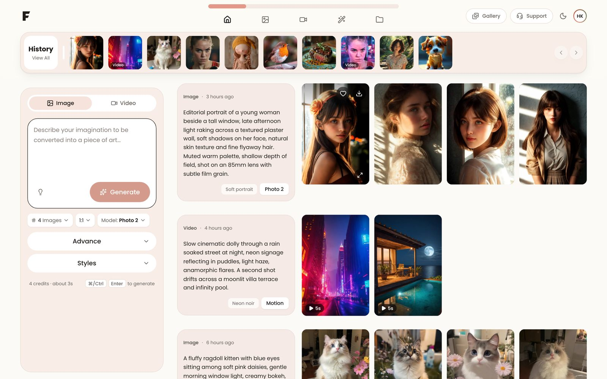
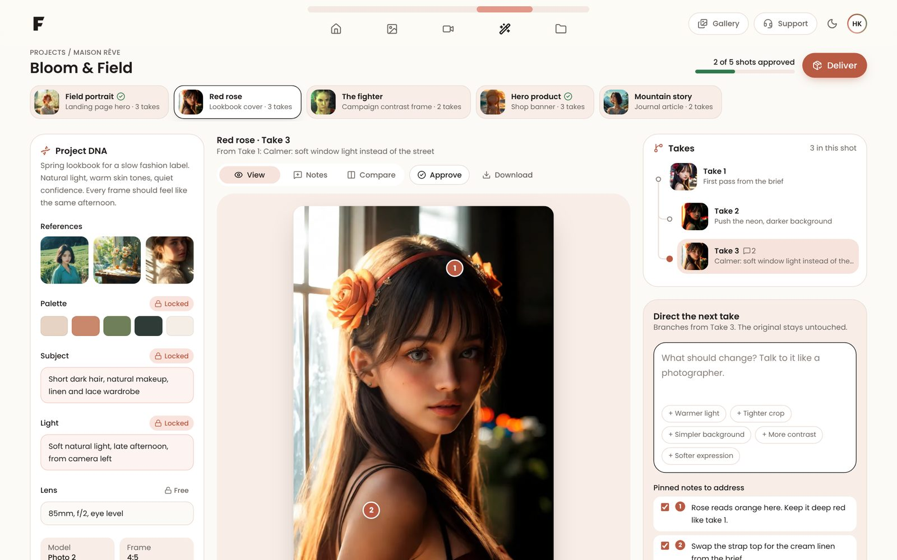

# Fomi · Frontend Assessment

A Next.js workspace for AI image and video generation, built for the FOMI frontend assessment.

* **Part A** (`/`): the generation workspace from the provided mockup, fully responsive, wired to a mock backend.
* **Part B** (`/studio`): **Direction Studio**, an original redesign of the Image Editing workspace for professionals who return to the same project every day.
* **Product thinking document**: [`docs/PRODUCT_THINKING.md`](docs/PRODUCT_THINKING.md), plus a print ready PDF ([`docs/Fomi-Product-Thinking.pdf`](docs/Fomi-Product-Thinking.pdf)). After deploying, put the Vercel link into [`docs/Fomi-Product-Thinking.html`](docs/Fomi-Product-Thinking.html) (search for "Add your Vercel link here"), open it in Chrome and use Print → Save as PDF.




## Run it

Requires Node.js 20.9 or newer.

```bash
npm install
npm run dev        # http://localhost:3000
npm run build      # production build
npm start          # serve the production build
npm run lint
```


## Stack

| Requirement | Used |
| --- | --- |
| Next.js | Next.js 16 (App Router), React 19, React Compiler |
| JavaScript | Plain JavaScript, no TypeScript |
| Tailwind CSS and/or CSS Modules | Tailwind CSS v4 for layout and styling, CSS Modules for the few components with custom CSS (nav indicator, segmented control, slider, sheet, skeleton) |
| Backend | Local API routes over JSON fixtures (`src/app/api`, `src/server`) |

Other dependencies are deliberately few: `lucide-react` for icons and `server-only` to keep server code out of the browser bundle.

## Project structure

```
src/
  app/                         Routes only: pages, layout, API route handlers
    api/
      generations/route.js     GET history (cursor pages), POST generate
      gallery/route.js         GET community inspiration
      catalog/route.js         GET models, ratios, styles
      studio/projects/[projectId]/route.js         GET a Studio project
      studio/projects/[projectId]/takes/route.js   POST iterate on a take
    studio/page.js             Part B
    page.js                    Part A
    layout.js, globals.css, error.js, not-found.js, icon.svg, fonts/
  components/
    ui/                        Design system primitives (Button, Select, Sheet, Toast, ...)
    layout/                    App header, navigation, menus
    media/                     Optimised image and video preview components
    providers/                 App wide providers and overlays (library, gallery, viewer)
  features/
    workspace/                 Part A: composer, feed, history rail, store
    library/                   Library, gallery and full screen viewer (code split)
    studio/                    Part B: stage, take tree, direction panel, project DNA, store
  hooks/                       useHotkey, useInView, useDismiss, useMediaQuery
  lib/                         API client, formatting, storage and download helpers
  server/                      Mock backend: JSON data, media matching, services
public/media/                  Images and videos (WebP and MP4)
docs/                          Product thinking document (Markdown and PDF)
```

Rules the code follows:

* `app/` contains routing only. Screens live in `features/`, shared building blocks in `components/`.
* Server code lives in `src/server` and imports `server-only`, so it can never end up in the client bundle.
* Each feature owns its state: `features/workspace/store` (generation history) and `features/studio/store` (a Studio project). Both use a pure reducer plus a provider, so the logic is easy to read and to test.

## Mock backend

All data is local JSON in `src/server/data`. The route handlers add realistic latency so loading states are visible.

| Endpoint | Description |
| --- | --- |
| `GET /api/generations?cursor=&limit=&type=` | History, newest first, cursor pagination (drives infinite scroll) |
| `POST /api/generations` | Validates input (422 on bad input) and returns a finished generation after a short delay |
| `GET /api/gallery` | Community inspiration items |
| `GET /api/catalog` | Models, aspect ratios, counts and style presets |
| `GET /api/studio/projects/:id` | The demo Studio project (`bloom-and-field`) |
| `POST /api/studio/projects/:id/takes` | Creates new takes from a parent take, a direction and pinned notes |

**Testing the error state:** put `#fail` anywhere in a prompt. The API answers 503 and the UI shows an error toast with Retry.

The mock "model" picks outputs by matching prompt words and style tags against the media library (with synonyms, so "puppy" finds dogs), so results relate to what you typed.

Your own generations, favourites, deletions and every Studio change are saved in `localStorage`, so a refresh keeps your work. In the Studio, **Deliver → Reset demo** restores the original project.

## Part A: notes on the implementation

**Fidelity.** Layout, colours, radii, typography (Poppins) and components follow the mockup: the progress style navigation, the sticky history strip, the pink composer panel with the Image/Video toggle, prompt box and Generate button, the `# Images`, ratio and `Model: Name` chips, the Advance and Styles sections, and the prompt card beside a four column image grid.

**Small, deliberate design changes**

* The Generate button and other accent text use a deeper coral (`#B95A43`) than the mockup's light coral. White text on the original colour fails WCAG contrast (about 2.3:1); the deeper tone passes AA (4.56:1) and keeps the same warmth.
* The prompt placeholder typo is fixed ("Describe your imagination…").
* Small additions that support real use: copy, reuse and delete on each prompt card, favourite and download on each output, an "Inspire me" prompt button, a credit and time estimate, and a dark theme.

**Responsive.** Phone, tablet, laptop and large displays are all supported with no horizontal scroll (checked from 360px to 1920px). The feed uses container queries, so a generation lays itself out based on the space the feed actually has, not the window width. On phones, navigation moves to a bottom tab bar within thumb reach.

**Performance**

* All imagery goes through `next/image` with explicit `sizes`, AVIF/WebP output, blur placeholders from the API and lazy loading. Only above the fold images load eagerly.
* Videos show an optimised poster and only fetch the MP4 when hovered or focused.
* The library, gallery, viewer and Deliver sheet are code split with `next/dynamic` and load on first open.
* React Compiler handles memoisation. State and actions live in separate contexts so buttons and menus do not re-render when the feed changes.
* The first page of history is rendered on the server; older pages stream in with an IntersectionObserver.
* Fonts are self hosted through `next/font/local` with `display: swap`.

**Accessibility**

* Semantic landmarks, a skip link, visible focus rings everywhere.
* Every custom control follows the matching WAI-ARIA pattern: listbox selects with full keyboard support, radio group segmented controls, switch, disclosure, and native `<dialog>` for sheets and the viewer (focus trap and Escape for free).
* Icon buttons always have a label (also shown as a tooltip). Status messages use a polite live region.
* `prefers-reduced-motion` is respected.
* Keyboard shortcuts: `/` focuses the prompt, `Ctrl/⌘ + Enter` generates, arrow keys browse the viewer, `Esc` closes panels.

**States.** Validation feedback, generating placeholders laid out like the final result with progress and Cancel, error toasts with Retry, empty states for filters, search and favourites, skeletons while pages load, an undo toast after delete, and a route level error boundary.

## Part B: Direction Studio

The full reasoning is in the product thinking document. In short, the Studio treats a professional's work as **a project made of shots**, and each shot as **a tree of takes**:

* **Pinned notes**: press `N` and click the image to leave feedback on the exact spot.
* **Direct the next take**: a written direction plus the pinned notes become new takes that branch from the selected one. Nothing is overwritten.
* **Take tree**: the lineage of every take, so it is always clear which direction led where.
* **Compare** (`C`): a before and after slider against the parent take.
* **Approve** (`A`): circle the one take that ships for a shot. Progress shows across the project.
* **Project DNA**: references, palette, subject, light and lens. Locked traits carry into every new take, so a whole lookbook stays consistent.
* **Deliver**: one place to download every approved take and see what still needs a pick.

On phones the Studio becomes four tabs (Stage, Takes, Direct, DNA).

## Credits

* Sample images and videos are derived from the public example outputs of [IC-Light](https://github.com/lllyasviel/IC-Light) (Apache 2.0) and [Kolors](https://github.com/Kwai-Kolors/Kolors), converted to WebP and short MP4 loops for this demo.
* Poppins font, SIL Open Font License (see `src/app/fonts/OFL.txt`).
* Icons by [Lucide](https://lucide.dev) (ISC).
